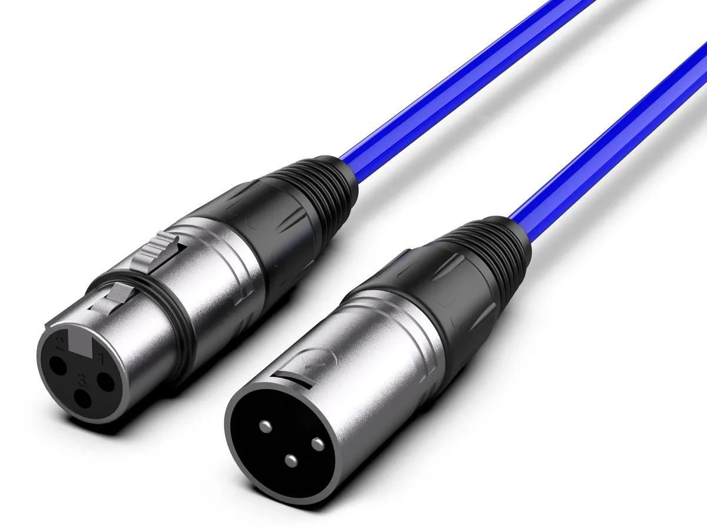

# Podcast 錄音入門：從麥克風到 Adobe Audition 後製

Podcast 看似只需要一支麥克風，按下錄音就可以開始。欸確實，不過，如果想要錄出「聽起來舒服、清楚、專業」的聲音，光靠麥克風是不夠的。你需要有好的錄音環境、適合的麥克風、正確的線材與錄音介面，還要懂得後製軟體的基本操作。

這堂課會從麥克風、XLR／TRS 線材、錄音介面、48V 幻象電源、平衡與非平衡訊號開始，最後實際使用 Adobe Audition 完成一次 Podcast 錄音、剪輯、降噪、EQ、多軌混音與輸出。

## 選擇適合的設備

工欲善其事，必先利其器。

### 麥克風

Podcast 錄音最重要的工具就是麥克風。

聲音本來是空氣中的壓力變化，而麥克風的工作，就是將這些聲波轉換成電訊號。

接下來錄音介面或 USB 麥克風中的 **ADC（Analog-to-Digital Converter，類比數位轉換器）**，再把類比電訊號轉換成電腦能夠處理的數位資料。

播放時則反過來：

**數位音訊 → DAC → 類比訊號 → 耳機／喇叭 → 空氣振動 → 耳朵**

理解這條 Signal Chain（訊號鏈）之後，後面談麥克風、錄音介面和線材就會容易很多。

#### 動圈麥克風 vs. 電容麥克風

麥克風可以分成兩種，分別是動圈麥克風與電容麥克風：

|             | 動圈麥克風 Dynamic               | 電容麥克風 Condenser                       |
| ----------- | -------------------------------- | ------------------------------------------ |
| 原理        | 振膜帶動線圈，在磁場中產生電訊號 | 振膜與背板形成電容結構，感應非常細微的變化 |
| 靈敏度      | 通常較低                         | 通常較高                                   |
| 聲音細節    | 相對集中、直接                   | 能捕捉更多細節與高頻                       |
| 環境噪音    | 通常比較不容易收到               | 比較容易錄到房間、冷氣與鍵盤聲             |
| 需要的 Gain | 通常較高                         | 通常較低                                   |
| 供電        | 一般不需要                       | XLR 電容麥克風通常需要供電                 |
| 常見用途    | Podcast、廣播、舞台、直播        | 錄音室、人聲、樂器、配音                   |

> [!NOTE] Gain 是什麼？
>
> Gain 是前級放大器的增益，通常用來控制麥克風訊號的大小。簡單來說就是音量。

動圈麥克風並不是「音質比較差」，電容麥克風也不是「一定比較好」。真正重要的是錄音情境。

如果在沒有做聲學處理的教室、房間或活動現場錄音，動圈麥克風較低的靈敏度反而是一項優勢；電容麥克風可以捕捉更多細節，但這些「細節」也包括冷氣、走廊上的人、鍵盤、電腦風扇和牆壁反射。

我們上課使用的 RØDE NT1 5th Generation 就是一支大振膜心形指向電容麥克風。它比較特殊的地方是同時具有 XLR 與 USB-C，所以既可以當傳統的錄音室麥克風，也可以直接變成 USB 麥克風使用。

> 以下提到的 NT1 USB 接法，指的是具有 USB 功能的 NT1 5th Generation。如果使用的是其他只有 XLR 的 NT1 型號，就必須經過錄音介面。

### 錄音介面 Audio Interface

傳統 XLR 麥克風送出來的是類比訊號（聲音），不能直接變成電腦裡的 WAV 或 MP3（檔案）。

因此我們通常需要 Audio Interface（錄音介面／音訊介面）。

它通常同時負責幾件事情：

| 功能              | 用途                       |
| ----------------- | -------------------------- |
| Microphone Preamp | 把非常微弱的麥克風訊號放大 |
| Gain              | 控制前級放大的程度         |
| Phantom Power     | 提供電容麥克風需要的電力   |
| ADC               | 將類比聲音轉成數位資料     |
| DAC               | 將電腦的數位音訊轉回類比   |
| Headphone Amp     | 驅動耳機                   |
| Monitor Output    | 輸出到監聽喇叭             |

這次我們要使用的 **RØDE AI-1** 是一台單通道錄音介面。它前面有一組 XLR／¼" Combo Input，因此一次只能接一支麥克風或樂器；另一方面，它具有兩個平衡 Line Output、耳機輸出、48V 幻象電源與 Direct Monitoring 可以直接聽到麥克風聲音。

假如未來要製作主持人與來賓各使用一支 XLR 麥克風、而且希望兩個人的聲音可以分開後製，就會需要至少具有 兩組 Mic Input / Preamp 的錄音介面。

### 不同的線材

在錄音室裡最常看到的線材是 XLR、TRS、與 TS。不過在解釋這幾個線材是用來幹嘛之前，我們要先來談談什麼是 **平衡（Balanced）**與 **非平衡（Unbalanced）**。

> 圖片來源：[台灣高空](https://www.taiwanaccess.com.tw/blog/posts/how-to-choose-cable)

#### 什麼叫平衡與非平衡？

**Unbalanced（非平衡）**的概念比較簡單：一條 Signal 加上一條 Ground。

問題是線材本身就像一條很長的天線，可能收到電源、燈具、無線設備等產生的電磁干擾。線越長，問題通常越明顯。

**Balanced（平衡）**則多一條訊號線。他會傳輸**Hot：原始訊號** 以及：**Cold：相反相位的訊號**

當兩條線一起經過環境時，外部產生的雜訊會大致同時進到兩條導線。接收端最後取兩條訊號之間的差異，原始訊號被恢復，而兩邊共同收到的干擾則會大幅抵消。

這叫做 **Common-mode Rejection（共模抑制）**。

因此當我們需要走比較長的線、接錄音室監聽喇叭或處理微弱的麥克風訊號時，通常會希望使用平衡傳輸。

#### TS

TS 代表 Tip / Sleeve，也就是插頭被分成兩個導體。

它通常用來傳輸非平衡的單聲道訊號。意思是說他比較沒有抗噪功能。

#### TRS

TRS 代表 Tip / Ring / Sleeve，也就是插頭被分成三個導體。

不過 TRS 不代表它一定是平衡訊號。

同一顆 TRS 插頭可以拿來傳：Balanced Mono：

> Tip = Hot Ring = Cold Sleeve = Ground

也可以拿來當一般立體聲耳機：Unbalanced Stereo：

> Tip = Left Ring = Right Sleeve = Ground

因此看到 TRS 不能直接判斷它是不是平衡訊號，要看設備的設計。

例如錄音介面的 6.35 mm TRS Line Output 經常是 **Balanced Mono**；但是你耳機上的 TRS 則是 **Stereo Headphone Signal**。

#### XLR

錄音最常看到的是三 Pin XLR：

| Pin   | 一般用途        |
| ----- | --------------- |
| Pin 1 | Ground / Shield |
| Pin 2 | Hot / +         |
| Pin 3 | Cold / −        |

它非常常被拿來傳輸麥克風的 Balanced Audio（平衡訊號）。

### 六、48V 幻象電源是什麼？

XLR 電容麥克風內部具有需要供電的主動電子電路，因此錄音介面可以透過 XLR 線材直接把直流電送進麥克風，不需要再額外拉一條電源線。最常見的是 P48，也就是 +48V。

所以如果我們採用：

**NT1 → XLR → AI-1**

就需要打開 AI-1 的 **P48 / 48V**。

但這堂課使用的是：

**NT1 → USB → 電腦**

這時候就不需要 AI-1 提供 48V，因為 NT1 會直接從 USB 取得電力，並且使用麥克風內建的 Preamp 與 ADC。NT1 5th Gen 的 USB 路徑與 XLR 路徑本來就是兩套不同的 Signal Path。

實際操作 XLR 設備時，養成一個好習慣：**先把 Gain 與監聽音量降低，接好麥克風，再開啟 P48；要拔線以前則先關掉 P48。**

## 七、這堂課實際怎麼接？

由於 AI-1 只有一組麥克風輸入，而我們使用的 NT1 5th Generation 本身就具有 USB Audio Interface，因此課堂會直接使用：

**NT1 → USB-C → 電腦 → Adobe Audition**

也就是讓 NT1 自己完成：

**Mic Capsule → Preamp → ADC → USB**

不再另外經過 AI-1。

RØDE 官方也將 NT1 5th Gen 的 USB-C 定義成包含內建 Revolution Preamp 與 ADC 的數位路徑，因此這不是「不用錄音介面」，而是**錄音介面已經被做進麥克風裡了**。

### 那兩個人怎麼一起戴耳機？

我們有另外一台 **Behringer HA400 Headphone Amplifier**。

HA400 會把同一份 Stereo Monitor Signal 分配成四個耳機輸出，而且四個人可以分別控制自己的耳機音量。官方將它定義為四聲道 Stereo Headphone Amplifier。

因此監聽的概念會變成：

**電腦／可用的監聽輸出 → HA400 INPUT → Headphone 1 / Headphone 2 / Headphone 3 / Headphone 4**

實際使用時可以從電腦的耳機輸出，或其他適當的 Stereo Monitor Output 將聲音送入 HA400。HA400 的輸入與耳機端都是 ¼" 立體聲接頭，因此如果電腦是 3.5 mm 耳機孔，就需要適當的 **3.5 mm TRS → 6.35 mm TRS Stereo** 線材或轉接。

接線之前先把 HA400 每一軌的 Level 降低，再逐漸調高。HA400 官方也提醒，如果送進去的 Source Level 過高，本身仍然可能產生 Distortion。

另外要注意：**HA400 只是讓很多人「聽」同一個訊號，不會增加錄音聲道。**

如果兩個人對著同一支 NT1 說話，他們最後仍然會被錄在同一條 Audio Track 裡，後製時不能單獨調整其中一個人的 EQ、音量或降噪。

## 八、再好的麥克風也救不了糟糕的房間

新手很容易認為：

「有雜音沒關係，等等 DeNoise 就好了。」

但錄音最重要的一條原則其實是：

**能在錄音時解決的問題，就不要留到後製。**

空蕩蕩的教室有大量牆壁、桌面、玻璃與地板，聲音打到這些硬表面以後會反射回來。麥克風最後收到的就不只有你的直接聲音，還包含延遲幾毫秒到數十毫秒回來的反射聲。

結果就是我們常說的「房間感」、「空」、「糊」、「Echo」。

而降噪軟體很擅長處理穩定的冷氣聲、風扇聲或 Hiss，卻很難把已經與人聲混在一起的 Room Reverb 完整拿掉。

RØDE 的 Podcast 指南也把錄音環境列為影響音質非常大的因素；大量磁磚、混凝土等反射表面會形成不舒服的 Echo 與頻率堆積。

實際錄音時，比起事後開超強 DeNoise，更有效的方法通常是關掉不必要的風扇、避開冷氣出風口、關上門窗、手機靜音，並善用窗簾、沙發、地毯、衣物等柔軟材質減少反射。

NT1 是 Side-address Microphone（側錄式麥克風），說話不是對著麥克風頂端，而是面向正面振膜；RØDE 的安裝指南也要求讓麥克風上的金色標記朝向 Pop Filter。

錄 Podcast 時可以先從嘴巴距離 Pop Filter 約 **10 cm 左右**開始測試。靠近麥克風通常可以提高 Voice 與 Room Noise 之間的比例，但太近又容易產生爆破音與過強的低頻，因此要搭配 Pop Filter 並實際監聽調整。

## 九、錄音前先認識 dBFS

在 Audition 裡看到的音量通常是 **dBFS（decibels relative to Full Scale）**。

數位音訊裡：

**0 dBFS 是上限。**

不是「剛好正常」，而是已經到天花板。

如果是一般 24-bit 錄音，一旦訊號超過數位系統能表示的範圍就會產生 **Clipping（削波／爆音）**，這種失真通常非常難修復。

因此錄音時不用追求波形塞滿整個畫面。

這堂課可以把正常說話時的 Peak 大約控制在：

**-12 ～ -6 dBFS**

偶爾比較大的聲音仍然保留一些 Headroom，不要碰到 0 dBFS。你提供的 Audition 教學也採用約 -12 到 -6 dBFS 作為人聲錄製的參考範圍。

# 十、我們統一使用 48 kHz / 24-bit

Sample Rate（取樣率）代表每秒對聲音取樣幾次。

常見的兩種規格是：

**44.1 kHz：音樂與傳統音訊常見**

**48 kHz：影片、廣播與影音製作非常常見**

不過這堂課我們直接統一採用：

**48,000 Hz / 24-bit**

其中一個很實際的原因是 NT1 5th Gen 的 USB 數位輸出原生提供 48、96 與 192 kHz，因此使用 48 kHz 最簡單，也可以直接銜接日後 Premiere Pro 或其他影片製作流程。

NT1 5th Generation 透過 USB 也支援 32-bit Float，但不要把它當成這堂課的必要條件。RØDE 目前說明，NT1 的 32-bit Float 搭配 Adobe Audition 可於 macOS 使用，但 Windows 上的 Audition 並不支援 NT1 的這種 32-bit Float 錄製模式，因此為了讓不同電腦的課程流程一致，我們採 **24-bit** 即可。

# 十一、Adobe Audition：從零開始完成一段 Podcast

接下來正式進入實作。這裡的重點不是背下每一個按鈕，而是理解一個完整的 Audio Workflow。

1. **設定輸入與輸出裝置。** 開啟 Audition 後，Windows 可以進入「編輯（Edit）→ 偏好設定（Preferences）→ 音訊硬體（Audio Hardware）」；macOS 則從「Adobe Audition → 設定（Settings）→ Audio Hardware」進入。將 Default Input 設為 **NT1 5th Generation**，Default Output 則選擇實際用來監聽的設備。Adobe 官方也要求在開始 Waveform 錄音以前先設定好 Audio Input。 如果開始監聽之後從喇叭聽到自己的聲音，再被麥克風收回去，就可能形成 Feedback，所以錄音時應使用耳機而不是把聲音直接放到喇叭。RØDE 對 NT1 USB 監聽也同樣建議使用耳機。

2. **建立第一個單軌錄音。** 選擇「檔案（File）→ 新增（New）→ 音訊檔案（Audio File）」，建立例如 `voice_raw.wav`。Sample Rate 設 **48000 Hz**，Channels 選擇 **Mono（單聲道）**，Bit Depth 使用 **24-bit**。Podcast 的單一麥克風本身就是一個 Mono Source，所以沒有必要把完全相同的聲音錄進左右兩邊。按下下方紅色「錄音（Record）」開始說話，再按「停止（Stop）」或 Space 停止。

3. **錄一小段 Room Tone。** 真正開始講話前不要馬上出聲，先保持安靜錄個幾秒鐘。這段只有房間、冷氣與麥克風底噪的聲音稱為 Room Tone，之後如果要使用 Noise Print 做比較精細的降噪，就會非常有用。錄製時觀察 Level Meter，確保正常說話大約落在 -12 到 -6 dBFS，不要碰到 0 dBFS。

4. **先做基本剪輯。** Waveform Editor 可以直接框選不需要的部分，再按 Delete 刪除，例如開頭準備麥克風的聲音、講錯重新說的句子，或尾端的雜音。Audition 的 Waveform Editor 比較接近直接修改音訊資料的 Destructive Editing；相較之下，等等使用的 Multitrack 更適合做 Non-destructive Editing。這也是你提供的兩份教學一直強調 Waveform 與 Multitrack 差異的原因。

5. **降噪 Noise Reduction。** 比較簡單的方法是「效果（Effects）→ 降噪／修復（Noise Reduction / Restoration）→ DeNoise」，一邊播放、一邊慢慢增加 Amount，直到冷氣或底噪減少，但人聲還是自然為止。不要追求完全沒有背景聲，降噪過頭的人聲會出現水聲、金屬感與人工感。如果遇到非常固定的 Hiss 或 Hum，也可以在 Waveform Editor 先選取前面錄下來的 Room Tone 作為 Noise Print，再使用 Noise Reduction Process。Adobe 官方指出 Noise Reduction 對持續性的背景噪音、麥克風底噪與電源 Hum 特別有效，而 Real-time Restoration Effects 則可以直接在 Waveform 與 Multitrack 中使用。

6. **使用 EQ 整理聲音。** 打開「效果（Effects）→ 濾波與等化器（Filter and EQ）→ 參數等化器（Parametric Equalizer）」。EQ 不是「讓聲音變好聽」的魔法，而是控制不同 Frequency 的音量。人聲通常可以先嘗試 High-pass Filter 處理約 70～100 Hz 以下不必要的桌面震動、冷氣與低頻 Rumble；如果聲音太悶，可以觀察約 200～400 Hz；如果語音不夠清楚，則可以很輕微地觀察 2～5 kHz。這些數字只能當起點，每個人的聲音都不同，不要看到教材寫 +3 dB 就全部照抄。Adobe 的 Parametric Equalizer 可以獨立控制 Frequency、Gain 與 Q，因此很適合學習「找到問題 → 小幅修正 → A/B 比較」。

7. **學會 Compression，而不是把波形全部拉大。** Podcast 常見的另一個問題是講話忽大忽小。Compressor（壓縮器）會在訊號超過 Threshold 之後按照 Ratio 降低它的動態範圍。例如 Ratio 3:1 的概念，就是超過 Threshold 的部分每增加 3 dB，輸出只增加約 1 dB。人聲可以先從約 2:1～3:1 的輕度壓縮開始，再用耳朵判斷。壓縮不是越多越好；過強會把呼吸、嘴巴聲與背景 Noise 一起拉得很明顯。Audition 也提供 Speech Volume Leveler 等針對對話的工具，用來縮小不同段落之間的音量差異。

8. **進入 Multitrack。** 接著使用「檔案（File）→ 新增（New）→ 多軌工作階段（Multitrack Session）」，Sample Rate 同樣設定 **48000 Hz**。可以把 Track 1 命名為 `Voice`、Track 2 命名為 `Music`，有需要再放 `SFX`。將剛剛的人聲拖進 Voice，再把片頭、片尾或背景音樂拖進 Music。Multitrack 最大的好處是 Clip 可以任意移動、縮短、拉回，Effects Rack 也可以隨時關閉與修改，不會直接破壞原始錄音。Adobe 將 Multitrack Editor 定義為 Real-time Editing Environment，可以同時混合大量 Track 與 Clip。 在每個 Clip 的角落拖曳可以製作 Fade In / Fade Out，把兩個 Clip 重疊則可以產生 Crossfade；M 是 Mute，S 是 Solo。這些也是你提供的 Audition 教學中多軌章節的主要操作。

9. **處理人聲與背景音樂的關係。** Podcast 裡最重要的永遠是「聽得懂人在說什麼」。因此 Music Track 不應該和人聲搶音量。可以使用 Clip Volume 或 Track Fader 把背景音樂降低，開頭沒有講話時稍微大聲，主持人開始說話後再降低。如果想進一步練習，可以打開「視窗（Window）→ 基本音效（Essential Sound）」把 Voice 標記成 Dialogue、Music 標記成 Music，再嘗試 Ducking，讓音樂在人聲出現時自動降低。也可以直接在 Track Effects Rack 加入 EQ、Compressor 等效果，這樣修改的只是播放時的 Processing，而不是改寫原始 WAV。Adobe 也支援 Bus，把多條人聲先送進同一條 Bus，再統一處理 EQ、Compression 與 Volume。

10. **做最後的 Loudness 與 Export。** 「很大聲」和「聽起來音量一致」不是同一件事。Peak Normalization 只是讓最高的 Sample 到達某個峰值；Podcast 更常需要考慮的是 LUFS，也就是比較接近人類感受到的整體 Loudness。Audition 可以從「視窗（Window）→ 匹配響度（Match Loudness）」分析並調整。Adobe 的 Podcast 文件建議 Podcast 可落在約 **-20 ～ -16 LUFS**，並提供 **-18 LUFS** 作為 Podcast 工作流程的參考，因此這堂課可以直接統一採用 **-18 LUFS、True Peak 不高於約 -1 dBTP** 作為練習標準。 完成後使用「檔案（File）→ 匯出（Export）→ 多軌混音（Multitrack Mixdown）→ 整個工作階段（Entire Session）」輸出最終作品；也可以使用「多軌（Multitrack）→ Mixdown Session to New File」先把整個 Mix 開到 Waveform Editor 做最後檢查。這兩種方式目前都仍是 Adobe 官方文件中的正式工作流程。

# 十二、Waveform 與 Multitrack 到底什麼時候用？

這是整堂 Audition 課最重要的觀念之一。

| Waveform Editor                   | Multitrack Editor                       |
| --------------------------------- | --------------------------------------- |
| 編輯一個 Audio File               | 同時處理多個 Clip / Track               |
| 適合裁切、修復與分析              | 適合 Podcast、音樂、配樂與混音          |
| Process Effect 可直接改變檔案內容 | Effects Rack 可以隨時修改               |
| 適合 Noise Print 等精細修復       | 適合 EQ、Compression、Volume Automation |
| 儲存後會改變該 Audio File         | 原始素材通常維持不變                    |

因此一個比較穩健的工作流程是：

**Recording / Cleanup → Multitrack Editing → Mixing → Loudness → Export**

不要每錄完一句話就急著把所有效果直接 Apply 到原始檔。

# 十三、降噪不是越乾淨越好

很多第一次使用 Audition 的人，打開 DeNoise 後會非常開心地一路拉到最大。

你會發現：

「哇，背景真的完全沒聲音了！」

但仔細聽，人聲可能也開始變成像在水裡講話。

Noise Reduction 本質上是在判斷「哪些內容比較像 Noise」，然後把它壓低。但現實世界裡，人聲與噪音在 Frequency Domain 中往往會重疊，因此不可能永遠完美分離。

Adobe 對 Noise Reduction 的官方說明也強調，實際 Reduction Amount 必須依 Noise 與可以接受的音質損失決定；對嚴重的 Noise 做過強的 Reduction，代價就是 Voice Quality。

所以我們真正追求的是：

**Noise 不再妨礙聆聽，而不是 Noise 數值等於零。**

# 十四、EQ 不要背公式，要學會「聽」

Parametric EQ 打開之後會看到一張圖。

橫軸是 Frequency：

**左邊 = 低頻**

**右邊 = 高頻**

縱軸則是 Gain。

往上代表 Boost，往下代表 Cut。

例如低頻出現「轟轟」的桌面振動，可以使用 High-pass Filter；如果某一小段 Frequency 出現很刺耳的 Resonance，可以把一個 EQ Band 的 Q 調窄、暫時 Boost，再左右 Sweep 找出最難聽的位置，找到之後再把那個 Frequency Cut 下去。

這種技巧通常稱為 **Sweep and Cut**。

但最重要的一件事情是：調完以後一定要把效果 Bypass，再聽一次 Before / After。

如果關掉 EQ 反而比較自然，那就代表這次 EQ 沒有幫忙。

# 十五、Normalization、Compression、Loudness 是三件不同的事

這三個功能很容易被新手混在一起。

| 工具           | 在處理什麼？                                      |
| -------------- | ------------------------------------------------- |
| Normalize      | 把整段 Audio 一起放大或縮小，使最高 Peak 到指定值 |
| Compressor     | 壓低較大的部分，改變 Dynamic Range                |
| Match Loudness | 依整體感知響度調整到指定 LUFS                     |

Adobe 官方對 Normalize 的定義就是依最高 Peak 等比例調整整個檔案，因此小聲與大聲之間的比例不會因 Normalize 自動變平均。

所以：

**Normalize ≠ Compressor**

也：

**Peak ≠ Loudness**

這幾個概念分清楚之後，很多後製操作會突然合理很多。

# 十六、最後要存 WAV 還是 MP3？

兩個都可以，但目的不同。

**WAV** 通常使用未壓縮 PCM，檔案比較大，但很適合作為 Master File、保存原始錄音以及之後再次剪輯。

**MP3 / AAC** 則會進行 Lossy Compression，犧牲部分資料來大幅降低檔案大小，因此更適合實際上傳與分享。

Adobe 的 Podcast 文件目前仍將 MP3 與 AAC 列為主要 Podcast Delivery Format，並指出 128 kbps MP3 是常見的 Stereo Podcast 輸出設定。

因此這堂課建議保留兩份：

| 用途                  | 建議格式             |
| --------------------- | -------------------- |
| Master / 保存         | WAV，48 kHz / 24-bit |
| 上傳／作業預覽        | MP3，128 kbps        |
| 純語音                | Mono 即可            |
| 有 Stereo Music / SFX | Stereo               |

永遠保留 WAV Master。今天覺得 128 kbps MP3 夠用，不代表幾個月後重新製作影片時還會希望手上只剩一個已經被壓縮過的 MP3。

# 十七、課堂練習：做出自己的第一段 Audio

這堂課不要求大家一定要做「正式 Podcast」。

你可以錄製任何適合拿來練習聲音製作的內容。

| 類型     | 可以做什麼                             |
| -------- | -------------------------------------- |
| 自由談話 | 講一件最近發生的事情、故事、心得       |
| Podcast  | 模擬主持人開場、評論、訪談             |
| 唱歌     | 錄一小段 Vocal，練習 EQ 與 Compression |
| 語音教學 | 挑一個自己熟悉的領域，教大家一個概念   |
| 技術分享 | 例如「Git 到底在解決什麼問題？」       |
| 興趣介紹 | 相機、遊戲、音樂、社團、運動皆可       |

如果不知道要講什麼，很推薦使用「語音教學」：

**挑一個你比班上其他人多懂一點點的東西，試著只靠聲音，在一兩分鐘內把它講到讓別人聽懂。**

這同時也是一個很好的 Podcast 練習，因為你會開始注意語速、停頓、重音、結構和聽眾到底聽不聽得懂。

# 十八、這次實作至少要碰過哪些功能？

最後完成作品時，可以用下面這張表自我檢查：

| 技能                               | 完成 |
| ---------------------------------- | ---- |
| 正確選擇 NT1 作為 Audio Input      | □    |
| 48 kHz / 24-bit 錄音               | □    |
| 錄製並觀察 -12 ～ -6 dBFS Level    | □    |
| Waveform 裁切口誤／空白            | □    |
| DeNoise 或 Noise Reduction         | □    |
| Parametric EQ                      | □    |
| Compression / Voice Leveling       | □    |
| 建立 Multitrack Session            | □    |
| 至少使用兩條 Track                 | □    |
| 調整 Clip / Track Volume           | □    |
| Fade In / Fade Out                 | □    |
| 適當加入 Music / SFX（若作品需要） | □    |
| Match Loudness                     | □    |
| Export Multitrack Mixdown          | □    |
| 輸出 WAV Master                    | □    |
| 輸出 MP3                           | □    |

背景音樂如果不是自己製作，請使用具有適當授權的音樂素材，例如 Creative Commons、Public Domain 或明確允許使用的 Royalty-free Music，而不是直接把喜歡的商業歌曲抓進來。

# 十九、比後製更重要的事情

學完 Audition 之後，很容易產生一個錯覺：

「反正什麼都可以修。」

但真正專業的錄音流程剛好相反。

如果房間很吵，就先讓房間安靜。

如果麥克風太遠，就先移近。

如果 Gain 太大，就先調 Gain。

如果一直噴麥，就先調整距離和 Pop Filter。

如果兩個人音量差很多，就先改善 Mic Technique。

後製是讓一段**本來就不錯的錄音變得更完整**，而不是讓一段完全失敗的錄音起死回生。

一支幾千元甚至幾萬元的電容麥克風放在充滿 Echo 的空房間裡，不一定會比一支普通動圈麥克風靠近嘴巴錄出來的聲音更適合 Podcast。

所以這堂課真正希望大家帶走的，不只是「Audition 的 DeNoise 在哪裡」，而是一套完整的 Audio Thinking：

**先聽問題 → 找出問題發生在哪一段 Signal Chain → 優先從源頭解決 → 最後才使用後製工具。**

只要掌握這個觀念，不管未來換成 Adobe Audition、Reaper、Logic Pro、Pro Tools、DaVinci Resolve，甚至只拿手機錄音，核心的方法其實都一樣。
